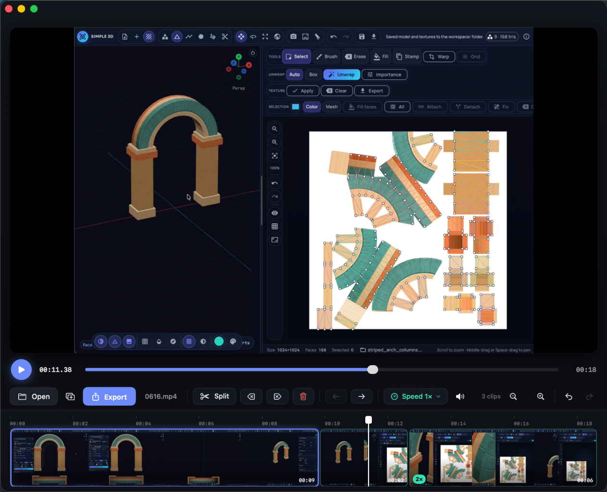

# Reel

**A simple, native video editor for macOS.**


I just wanted a dead-simple way to trim, cut and speed up screen recordings on my
Mac — without launching a heavyweight timeline editor, learning a new tool, or
paying a subscription. So I built **Reel**: a small, fast, fully native app that
does the handful of things I actually need and nothing else.



## What it does

- **Record** any resizable portion of any connected display, with optional
  speaker/system audio.
- **Open** a MOV / MP4 (file dialog or just drag-and-drop).
- **Append** more clips at the end — different sizes/orientations are aspect-fit
  into a common frame automatically.
- **Split & trim** — drop the playhead and hit **Split**, **Delete** a chunk, or
  trim the start/end with **Delete Before / After**. Select a clip to reveal
  green handles wherever source footage can be recovered; drag either direction
  to extend or shorten that edge, or double-click it to restore the entire side.
- **Reorder** clips by dragging them directly in the timeline — it autoscrolls
  when you hold a clip near either edge — or use the earlier/later buttons.
- **Re-time** — change the playback **speed** of selected clips (or all of them),
  from presets or any custom value you type.
- **Mute video audio** with one click.
- **Add a separate audio track** for music or narration. It appears as a thin
  lane above the video and supports the same selection, cut, trim, move and
  speed tools, plus volume and fade-in / fade-out controls. This track stays
  audible when the video-audio mute toggle is on.
- **Undo / Redo** every edit.
- **Preview & scrub** with a zoomable timeline — what you preview is exactly what
  you export.
- **Export** to **MP4**, or **Copy** the edited video directly to the clipboard,
  with shared fixed-resolution or 75% / 50% / 25% resize options and six H.264
  / HEVC compression levels.

That's the whole app. No accounts, no cloud, no watermark.

## iPhone companion

Reel also has a native iPhone and iPad companion (iOS 17+), built in this repo
as the **ReelMobile** target. It shares the timeline models, editing engine, and
MP4 exporter with the Mac app.

- Import one or more videos from Photos or Files, including screen recordings.
  Photos uses the current video encoding to avoid unnecessary conversion. Loading
  shows provider progress and can be cancelled; iCloud originals may need downloading.
- Split, trim, join, reorder, change speed, mute, undo, and redo.
- Drag the filmstrip beneath the fixed playhead to scrub. Fit shows the whole
  edit across the available width, with the playhead moving over the clips.
  Selecting a clip preserves the current frame in either view.
- Tap a clip to reveal its trim handles, then drag either edge. Pinch to zoom,
  or use Fit and the zoom controls. Hold a clip, then drag it along the timeline
  to reorder. Clips make room as you drag, and holding near either edge scrolls
  the timeline. Each drop is one undo step.
- Tap Audio to reveal sound lanes on the same time axis. Split the audio at both
  ends of a spot, tap that section, then lower its volume or mute it. Video stays
  continuous. Original sound stays attached when video is trimmed, moved or
  retimed. Added audio has its own lane and volume controls. Real waveforms load
  in the background. Audio cuts and volume changes support undo and save in drafts.
- Crop changes the entire edit: use Original, 9:16, 1:1, 4:5 or 16:9, or drag
  the custom crop corners. Move the crop frame to choose what stays visible.
- Frame changes one video clip: drag to reposition, pinch to zoom, and rotate
  with two fingers. Zoom and rotation sliders, Fill, 90° and Reset are also
  available. Apply makes one undo step; Cancel leaves the edit unchanged.
  Crop and framing persist in drafts and use the same matrix in preview/export.
- Fade in the audio controls smooths transitions to neighboring sections over
  up to 0.2 seconds. Muted sections stay silent throughout; louder neighbors
  fade down to them and back up. Fade works for original and added audio.
- Add an audio file from the import menu.
- Export MP4 with resolution and H.264/HEVC compression options, then share,
  save to Files, or choose Save Video in the share sheet to save to Photos.
- The current draft saves on device automatically and restores on launch.
  Imported footage is copied into Reel, so provider access can safely expire.
- Portrait and landscape layouts are supported. Keep Reel open during export.

Screen recording uses the iPhone's built-in recorder, followed by import into
Reel. The Mac's region recorder is available in the Mac app.

Open `Reel.xcodeproj`, select **ReelMobile**, choose your signing team and iPhone,
and run. Signing credentials are configured locally. To install on a paired
phone from the terminal, provide your own Apple Developer team ID:

```sh
TEAM=YOUR_APPLE_TEAM_ID ./scripts/install-ios.sh YOUR_DEVICE_UDID
```

To run the integration and interface tests, choose the ReelMobile scheme and an
iPhone simulator, then use Product > Test. The tests cover edits, draft recovery,
mixed-orientation MP4 export, added audio, and the mobile editing/share flow.
The Photos picker smoke test needs a video in the simulator Photos library and
skips when the library is empty or the simulator's Photos picker is unavailable.

## Record a screen region

1. Click **Record** (or press **⇧⌘R**).
2. On any connected display, drag to draw a new region, drag inside the dotted
   border to move it, or use the eight handles to resize it exactly.
3. Leave **Speaker audio** checked to include the sound playing through macOS,
   or turn it off for a silent recording.
4. Click **Record** in the floating selection controls.
5. Click the red dot in the macOS menu bar and choose **Stop Recording**, or
   press **⌘Esc** when you are done.

Recordings are saved as MOV files in `~/Movies/Reel` and open in Reel
automatically, ready to trim or export. If a video is already open, the new
recording is appended to the end of its timeline instead. Reel's own windows and
sounds are excluded from the capture.

The first time you record, macOS asks for Screen & System Audio Recording
permission. If permission still needs to be enabled, Reel opens **System
Settings → Privacy & Security → Screen & System Audio Recording** directly;
enable Reel there, then relaunch the app. If Reel is not yet listed, click
**Add** and select the copy of `Reel.app` you are running.

## Download

Grab the latest **`Reel.zip`** from the
[Releases](https://github.com/LorenzGit/video-edit/releases/latest) page — no
Xcode needed. Unzip it and drag **Reel.app** into your Applications folder.

Reel is a free build that isn't signed through Apple's paid Developer Program, so
the first time you open it macOS will say it can't verify the app. That's normal
for indie apps shared this way — the entire source is right here if you'd rather
build it yourself. To open it the first time:

1. Double-click **Reel.app** (macOS blocks it on the first try).
2. Go to **System Settings → Privacy & Security**, scroll down, and click
   **Open Anyway** next to the note about Reel.
3. Confirm once more. macOS remembers your choice from then on.

Prefer the terminal? One line clears the quarantine flag:

```sh
xattr -dr com.apple.quarantine /Applications/Reel.app
```

## Requirements

- macOS 14.0 or later
- Xcode 16 or later (built and tested with Xcode 26.5)

## Build & run

The Xcode project is generated with [XcodeGen](https://github.com/yonaskolb/XcodeGen)
from `project.yml`, and is already checked in, so you can open it directly:

```sh
open Reel.xcodeproj
```

Then press **⌘R** in Xcode to build and run. (The first run signs the app to run
locally with your own developer identity.)

If you change `project.yml` or add/remove source files, regenerate the project:

```sh
xcodegen generate
```

The app's bundle identifier is `com.gamojo.reel`. If you fork Reel and ship your
own build, change `bundleIdPrefix` / `PRODUCT_BUNDLE_IDENTIFIER` in `project.yml`
to your own.

To produce a distributable build yourself — certificate-signed when an Apple
Development identity is available, otherwise ad-hoc signed — run:

```sh
./scripts/build-release.sh   # writes dist/Reel.zip
```

The release script embeds a stable local signing requirement so macOS keeps the
Screen Recording permission associated with Reel across subsequent local
rebuilds.

## Keyboard shortcuts

| Action                    | Shortcut     |
|---------------------------|--------------|
| Open video                | ⌘O           |
| Import video at end       | ⌘I           |
| Add / replace audio track | ⌥⌘A          |
| Record / stop screen      | ⇧⌘R          |
| Stop screen recording     | ⌘Esc         |
| Export as MP4             | ⌘E           |
| Copy video to clipboard   | ⇧⌘C          |
| Play / Pause              | Space        |
| Split at playhead         | ⌘B           |
| Move clip earlier / later | ⌥⌘← / ⌥⌘→    |
| Delete before playhead    | ⌘[           |
| Delete after playhead     | ⌘]           |
| Delete selected clip      | ⌫            |
| Mute / restore video audio| ⌘M           |
| Zoom in / out / fit       | ⌘+ / ⌘- / ⌘0 |
| Undo / Redo               | ⌘Z / ⇧⌘Z     |

## How it works

The whole timeline is just an ordered list of `Chunk`s
([`Shared/Models/Chunk.swift`](Shared/Models/Chunk.swift)), each holding a
`sourceID`, a source time range, and a speed multiplier. Every edit takes a
snapshot of that list for undo/redo, then rebuilds an `AVMutableComposition`
([`Shared/Editing/EditorViewModel.swift`](Shared/Editing/EditorViewModel.swift)):
each chunk's range is appended in order from its source video, and `scaleTimeRange`
applies its speed. A matching `AVVideoComposition` places every source — whatever
its size or orientation — into a common frame (the first clip's), aspect-fit and
centred. That one composition feeds both the live `AVPlayer` preview and the
`AVAssetExportSession` MP4 export, so what you preview is exactly what you export.

## Project layout

```
Shared/
  Models/      Chunk, ImportedAudioTrack (shared timeline models)
  Editing/     EditorViewModel (edits, composition, playback, undo, platform adapters)
  Support/     Formatting, VideoExporter
Sources/       macOS app, views, ScreenCaptureKit recorder, and shared theme
iOS/           iPhone/iPad app, touch editor, Photos/Files import, sharing
Tests/         iOS integration and interface tests
```

The timeline is horizontally scrollable and zoomable; muting video audio drops
the source clips' audio track from the composition entirely. The separately
imported audio clips are inserted on their own composition tracks with an audio
mix for volume and fades, so they remain present in preview, export, and
clipboard copies regardless of that mute toggle.
Screen recording uses ScreenCaptureKit for an exact display-relative region and
AVAssetWriter for the MOV file, including an AAC system-audio track only when
requested.

## License

[MIT](LICENSE) — do whatever you like with it. If you build something fun on top,
I'd love to hear about it.
